# Unreal-AI-Glossary-Playground

"언리얼 AI 요청 용어집"의 **187개 용어를 하나씩 동작하는 예제 레벨**로 만든 학습용 UE 5.8 C++ 프로젝트입니다.
[Unity-AI-Glossary-Playground](https://github.com/jes79/Unity-AI-Glossary-Playground)의 언리얼 버전입니다.
각 레벨은 용어집의 "이렇게 요청하세요" 예문을 실제로 구현한 결과물이고, 대부분 켜기/끄기 비교로 차이를 보여 줍니다.

- Unreal Engine 5.8 · C++ (Visual Studio 2026) · Lumen · Nanite · Enhanced Input · Niagara · GAS · StateTree · MetaSounds · PCG
- 레벨 187개 + 허브 레벨 1개
- 구현 방식: 런타임 데모 170 · 설명 + 대체 구현 14 · 에디터 도구 데모 3
- 레벨·머티리얼·Niagara·사운드·Behavior Tree·StateTree·Level Sequence 등 **에셋을 코드로 생성** (손으로 만든 레벨 없음)
- 용어집 문서: [Claude Docs](https://claude.ai/code/artifact/e551ba89-bc77-4986-a284-ef21c7552635) · Notion DB "언리얼 용어 DB"

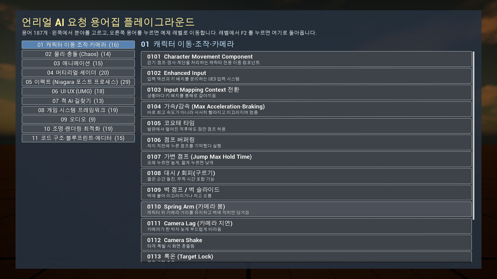

## 스크린샷

모든 레벨 왼쪽 위에 용어 · 쉽게 말하면 · 요청 예문 · 조작법 · 실시간 상태를 보여 주는 정보 패널이 있습니다.

| | |
| --- | --- |
| 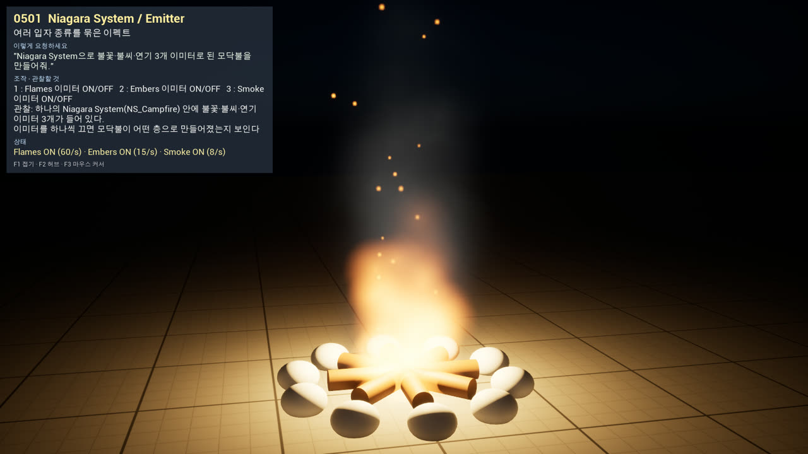 | 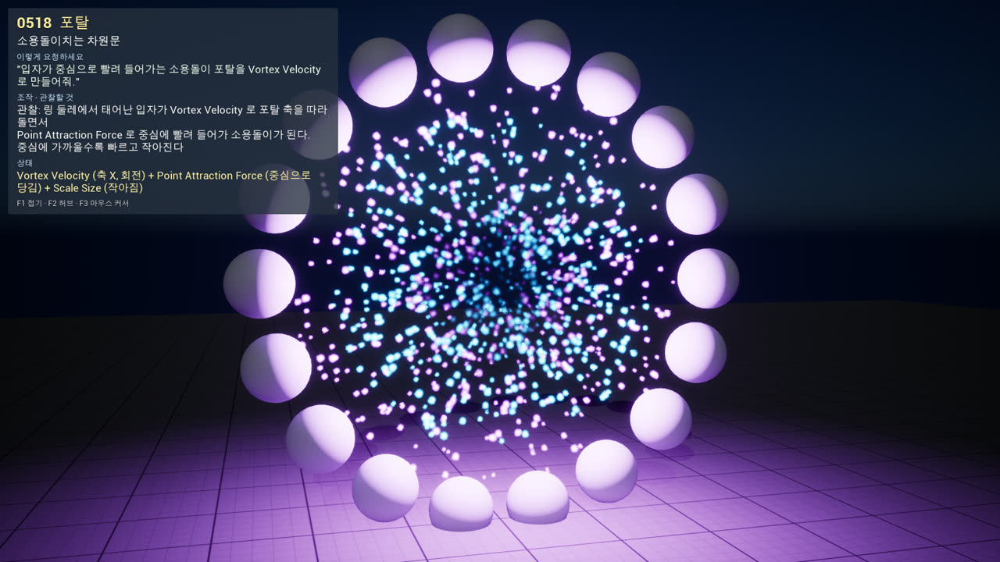 |
| **0501 Niagara System** · 코드로 만든 불꽃·불씨·연기 3 이미터 모닥불 | **0518 포탈** · Vortex Velocity + Point Attraction |
| 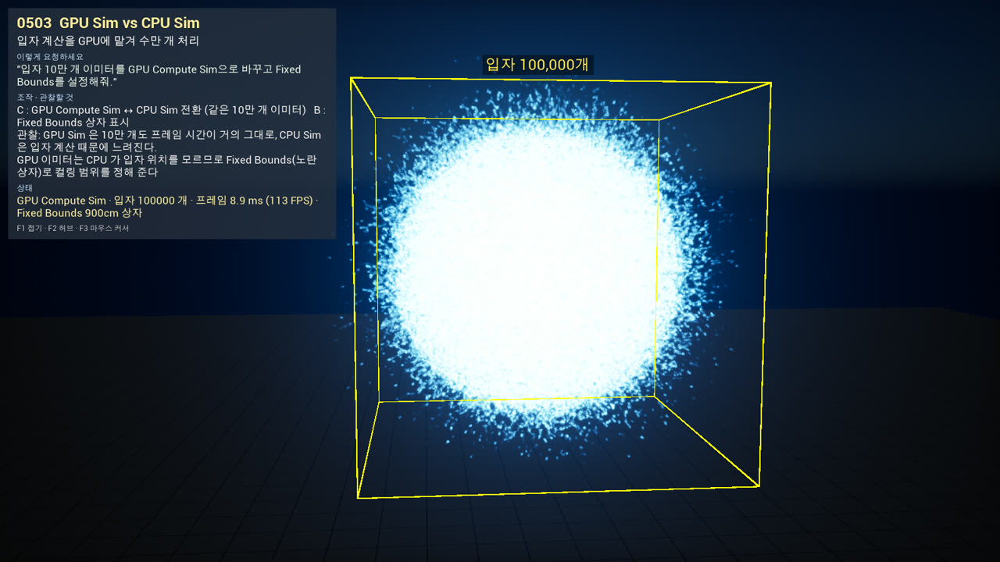 | 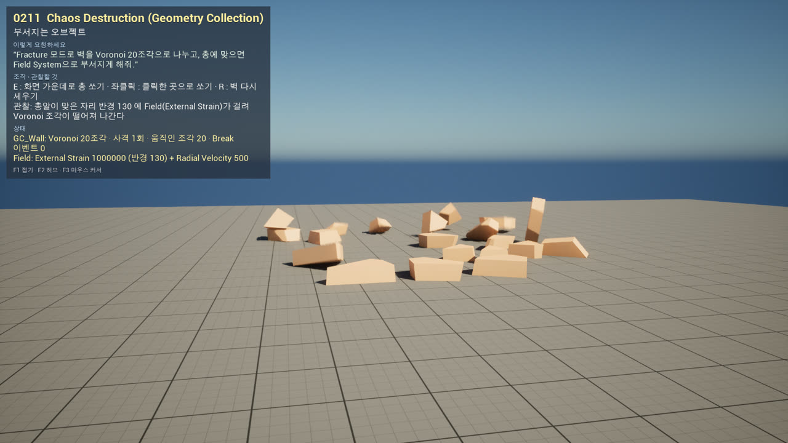 |
| **0503 GPU Sim** · 입자 10만 개, Fixed Bounds | **0211 Chaos Destruction** · 코드로 Voronoi 20조각, Field 로 파괴 |
| 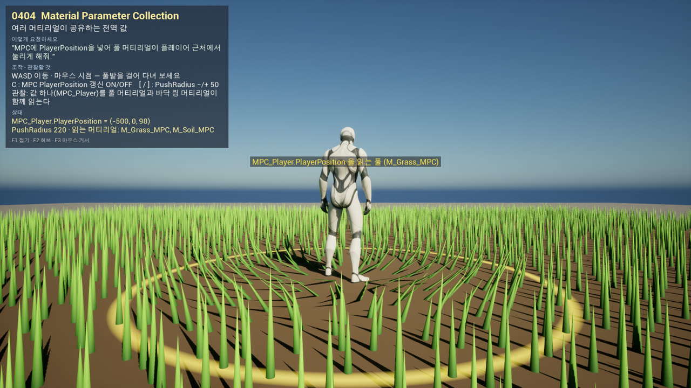 | 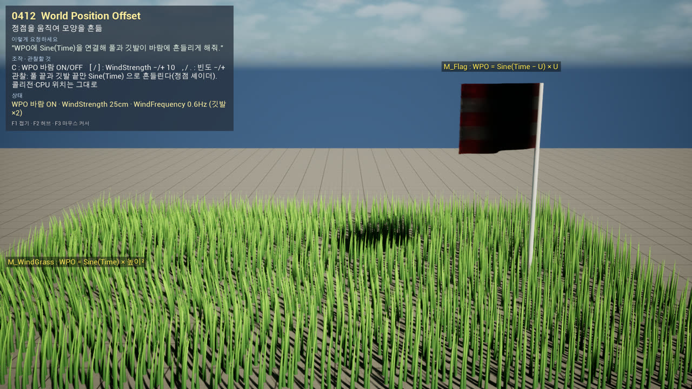 |
| **0404 Material Parameter Collection** · 플레이어 근처 풀이 눌림 | **0412 World Position Offset** · 바람에 흔들리는 풀·깃발 |
| 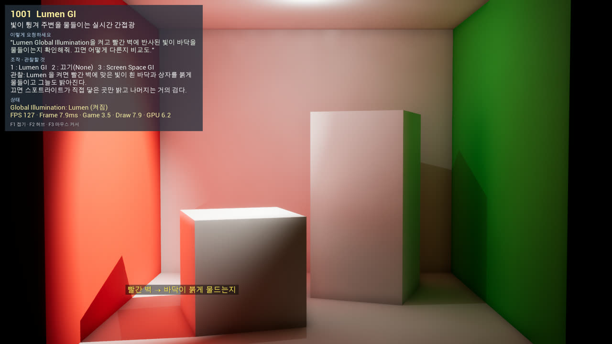 | 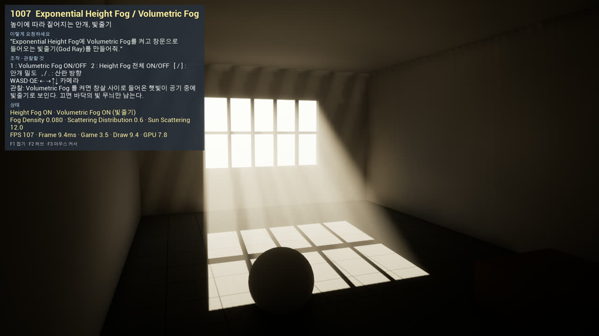 |
| **1001 Lumen GI** · 빨간 벽 반사광이 바닥을 물들임 | **1007 Volumetric Fog** · 창살 사이 빛줄기 |
| 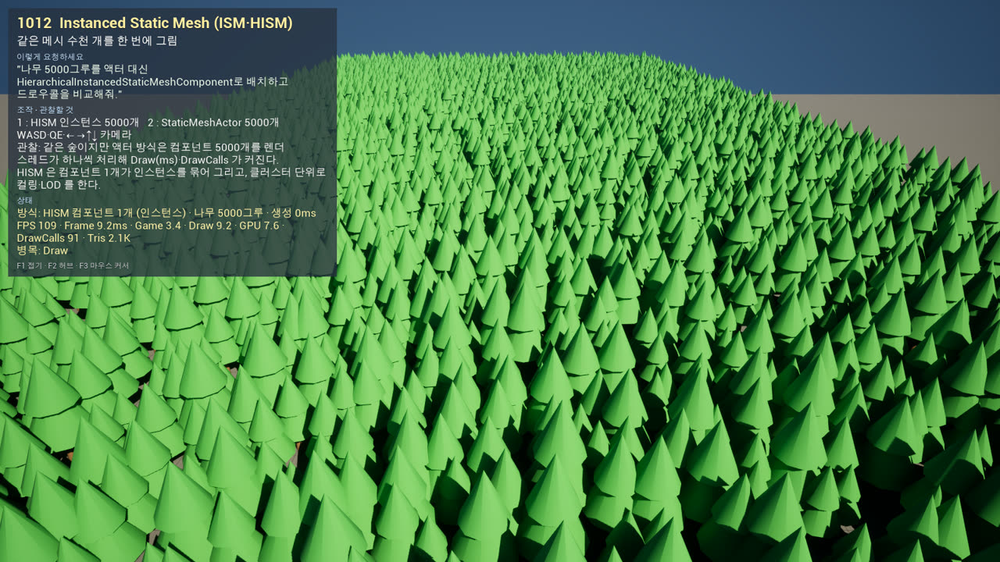 | 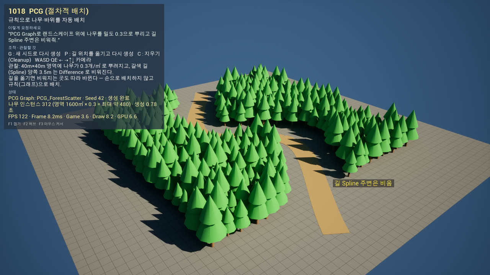 |
| **1012 HISM** · 나무 5000그루, 드로우콜 65 vs 4812 | **1018 PCG** · 코드로 만든 PCG 그래프, 길 주변 비우기 |
| 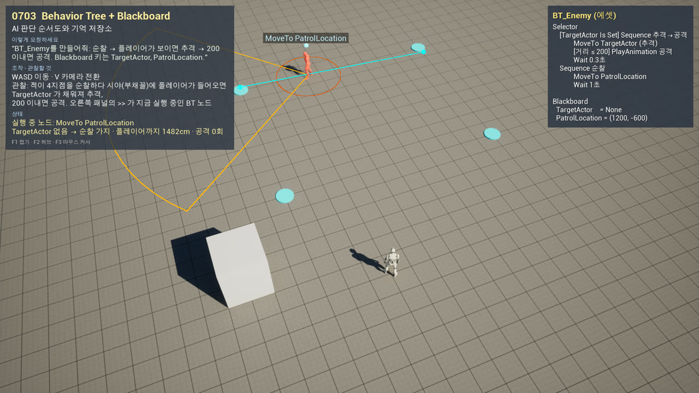 | 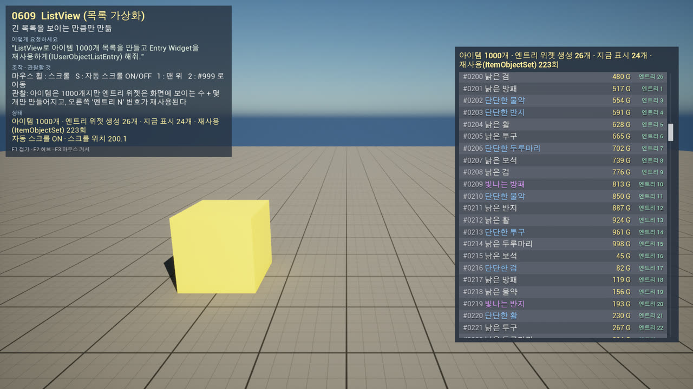 |
| **0703 Behavior Tree** · 순찰→추격→공격, 실행 노드·블랙보드 표시 | **0609 ListView** · 1000개 목록에 엔트리 위젯 26개 재사용 |

## 처음 열 때

1. Visual Studio 2026(또는 2022)에 **"C++를 사용한 게임 개발"** 워크로드와 **Windows 11 SDK(10.0.22621)** 가 필요합니다.
2. `GlossaryPlayground/GlossaryPlayground.uproject` 를 우클릭 → Generate Visual Studio project files → 빌드하거나, 명령줄에서:
   ```bash
   tools/build.sh
   ```
3. 에셋과 레벨을 코드로 생성합니다 (에디터를 닫고):
   ```bash
   tools/glossary-build.sh
   ```
   에디터 안에서는 `Tools > Glossary > Build All Levels` 메뉴와 같습니다.
4. 프로젝트를 열면 시작 맵이 `L_0000_Hub` 입니다. Play → 왼쪽에서 분야, 오른쪽에서 용어를 고르면 해당 레벨로 이동합니다.

각 레벨 왼쪽 위 정보 패널에 **용어 · 쉽게 말하면 · 요청 예문 · 조작법 · 실시간 상태**가 표시됩니다.
`F1` 패널 접기 · `F2` 허브로 · `F3` 마우스 커서 전환.

## 분야

| 번호 | 분야 | 레벨 | 모듈 |
| --- | --- | --- | --- |
| 01 | 캐릭터 이동·조작·카메라 | 16 | `GlossaryMovement` |
| 02 | 물리·충돌 (Chaos) | 14 | `GlossaryPhysics` |
| 03 | 애니메이션 | 15 | `GlossaryAnimation` |
| 04 | 머티리얼·셰이더 | 20 | `GlossaryMaterial` |
| 05 | 이펙트 (Niagara·포스트 프로세스) | 29 | `GlossaryEffects` |
| 06 | UI·UX (UMG) | 18 | `GlossaryUI` |
| 07 | 적 AI·길찾기 | 13 | `GlossaryAI` |
| 08 | 게임 시스템·프레임워크 | 19 | `GlossarySystems` |
| 09 | 오디오 | 9 | `GlossaryAudio` |
| 10 | 조명·렌더링·최적화 | 19 | `GlossaryRendering` |
| 11 | 코드 구조·블루프린트·에디터 | 15 | `GlossaryPatterns` |

레벨 이름 규칙: `/Game/Levels/{NN_분야}/L_{id}_{Name}` (예: `L_0105_CoyoteTime`), 데모 클래스 `ADemo{id}_{Name}`.
전체 목록은 `Source/GlossaryCore/Private/GlossaryCatalogData.inl`, 분야별 상세 표는 `docs/dev-notes/NN-*.md`.

## 구조

```
GlossaryPlayground/
  Source/GlossaryCore/      카탈로그, 데모 베이스, 정보 패널, 허브, 공통 환경·캐릭터, GlossaryKit(런타임 헬퍼), GlossaryAssetKit(에셋 생성)
  Source/GlossaryEditor/    레벨 빌더, GlossaryBuild 커맨드렛, Tools > Glossary 메뉴
  Source/Glossary{분야}/    분야별 데모 클래스 + 그 분야 에셋 빌더
  Content/Glossary/         빌더가 만든 에셋 (머티리얼·텍스처·사운드·Niagara·BT·StateTree…)
  Content/Levels/           빌더가 만든 레벨
  Content/Characters, Input, LevelPrototyping, Vehicles   엔진 템플릿에서 복사한 마네킹·입력·차량
docs/CONVENTIONS.md         새 데모를 추가할 때 지킬 규칙
docs/dev-notes/             분야별 구현 노트, Niagara 코드 생성 메모
tools/                      build.sh · glossary-build.sh · shot.sh(자동 스크린샷) · locked.sh
```

## 도구

```bash
tools/build.sh [모듈]                      # C++ 빌드 (모듈 하나만도 가능)
tools/glossary-build.sh [-filter=05]       # 에셋 + 레벨 생성 (분야·id 필터)
tools/shot.sh 0105 8 SpaceBar,C            # 레벨 실행 → 8초 뒤 자동 스크린샷(shots/0105.png), 그 전에 키 입력
```

## 대체 구현한 항목

에디터에서만 만들 수 있는 에셋이 필요한 용어는 같은 개념을 C++로 직접 구현하고, 실제 사용법을 정보 패널에 설명합니다.

| id | 용어 | 대체 방식 |
| --- | --- | --- |
| 0308 | Aim Offset | 조준 포즈 애니메이션이 없어 척추 본 회전 분배로 구현 |
| 0310 | Control Rig (Look At) | Aim + 60° 제한을 C++ AnimInstance 로 |
| 0311 | IK Retargeter | 다리 비율이 다른 체형 + 골반 높이 보정 리타깃 |
| 0312 | Motion Matching | 17클립 포즈 DB + 비용 최소 검색 직접 구현 |
| 0601 | Widget Blueprint | C++ 위젯 트리 + BindWidget 베이스 클래스 패턴 |
| 0607 | Widget Animation | UWidgetAnimation + MovieScene 트랙을 실행 중 조립 |
| 0616 | Common UI | ActivatableWidgetStack 은 실제, 버튼 스타일만 일반 UButton |
| 0617 | MVVM | 실제 Viewmodel(FieldNotify) + 코드 구독 (WBP 바인딩 대신) |
| 0618 | 현지화 | String Table + 실행 중 번역 등록 (.locres 대신) |
| 0713 | Mass | Mass Entity 코어 + ISM (Spawner·Trait 에셋 대신) |
| 0802 | GameInstance | 같은 수명의 GameInstanceSubsystem |
| 1005 | Light Mobility | 라이트맵 굽기 없이 Mobility 제약만 시연 |
| 1011 | HLOD | 빌더가 합친 프록시 메시 + 거리 전환 |
| 1017 | World Partition | 셀·Loading Range 스트리밍 규칙을 직접 구현 |

에디터 도구 데모: 1110 Editor Utility(Tools 메뉴 정렬 도구), 1111 Python 스크립트, 1112 Live Coding.
